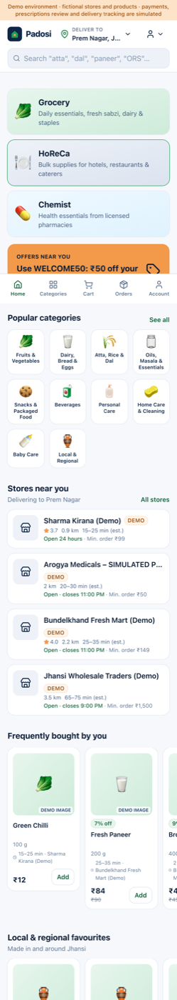
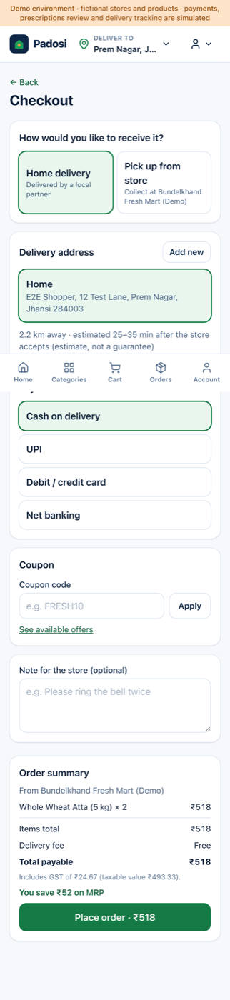
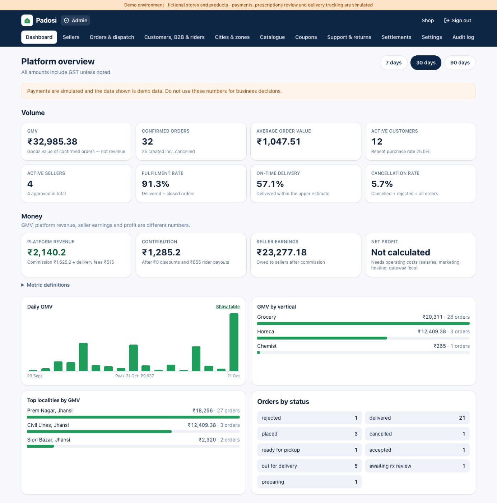

# Padosi — hyperlocal quick commerce for Tier-2 & Tier-3 India

A production-minded MVP that connects local grocery stores, HoReCa (hotel/restaurant/café) suppliers, licensed pharmacies, customers and delivery partners on one platform.

> **Padosi** ("neighbour") is a placeholder brand name. Change it with `NEXT_PUBLIC_BRAND_NAME` / `EXPO_PUBLIC_BRAND_NAME` and the colour tokens in `apps/web/app/globals.css`. Run a trademark check before using any name publicly.

**All demo data is fictional.** The demo city is Jhansi (UP), but every store, brand, licence, prescription, payment and delivery in the seed data is simulated and labelled as such.

| Mobile home | Checkout | Admin dashboard |
|---|---|---|
|  |  |  |

---

## What is in this repository

```
.
├── apps/
│   ├── api/             Express 5 + TypeScript REST API, Prisma ORM, PostgreSQL
│   │   ├── prisma/      schema.prisma, migrations, demo seed
│   │   ├── src/         routes/, services/ (pricing, quote, orders, delivery…), providers/ (payments, SMS, storage…)
│   │   └── tests/       integration tests for the 15 required journeys
│   ├── web/             Next.js 15 + Tailwind 4: customer, HoReCa, chemist, seller, delivery and admin portals
│   ├── customer-app/    Expo (React Native) customer app — SDK 58
│   └── delivery-app/    Expo (React Native) delivery-partner app — SDK 58
├── packages/shared/     Zod schemas, order state machine, GST/money maths, geo helpers (+ unit tests)
├── docs/                API reference, production & compliance checklist, screenshots
├── scripts/dev.mjs      starts database + API + web with one command
└── docker-compose.yml   optional Postgres/Redis for machines with Docker
```

The web app and the API are npm workspaces. The two Expo apps are standalone projects, because they need React Native's React version. They talk to the same API with bearer tokens.

---

## Run it locally on macOS (VS Code)

### 1. Prerequisites

- **Node.js 22 LTS.** If `node -v` fails, install it from <https://nodejs.org> or with `nvm install 22`.
  During development a copy was installed to `~/.local/node`. To use that one, add it to your shell once:
  ```bash
  echo 'export PATH="$HOME/.local/node/bin:$PATH"' >> ~/.zshrc && source ~/.zshrc
  ```
- Nothing else is required. PostgreSQL 17 runs from an npm package (`embedded-postgres`), so you do **not** need Docker or Homebrew. If you prefer Docker, `docker compose up -d postgres` works with the same settings.

### 2. Install and configure (once)

Open the folder in VS Code, open a terminal (<kbd>Ctrl</kbd>+<kbd>`</kbd>) and run:

```bash
npm run setup                                        # installs web/API workspaces and both mobile apps
cp apps/api/.env.example apps/api/.env               # skip if it already exists
cp apps/web/.env.example apps/web/.env.local         # skip if it already exists
```

### 3. Start the database and load demo data

```bash
npm run db:start      # terminal 1 — leave running (PostgreSQL on localhost:5433, data in apps/api/.data/pg)
npm run db:setup      # terminal 2, first time only — applies migrations and loads the Jhansi demo data
```

To wipe and reload demo data later, run `npm run db:reset`. It deletes everything in the local `padosi` database.

### 4. Start the API and web app

```bash
npm run dev:api       # http://localhost:4000/api/health
npm run dev:web       # http://localhost:3000
```

Or start database, API and web together in a single terminal with `npm run dev`. Press <kbd>Ctrl</kbd>+<kbd>C</kbd> to stop all three.

### 5. Sign in with a demo account

Open <http://localhost:3000/login>. In development the login page shows a **Demo accounts** panel with one-tap sign-in. You can also use the password `Demo@2026` (set by `DEMO_USER_PASSWORD`), or mobile OTP: the code appears on screen and in the API log.

| Role | Name | Mobile | Where to go |
|---|---|---|---|
| Customer | Aarti Verma | 9000000001 | `/` |
| Customer | Rohit Yadav | 9000000002 | `/` |
| HoReCa buyer (verified, ₹50k credit) | Vikram Singh | 9000000003 | `/business` |
| Seller — Sharma Kirana | Ramesh Sharma | 9000000011 | `/seller` |
| Seller — Bundelkhand Fresh Mart | Neha Gupta | 9000000012 | `/seller` |
| HoReCa supplier — Jhansi Wholesale | Imran Khan | 9000000013 | `/seller/rfqs` |
| Pharmacy owner (not a pharmacist) | Sunil Agarwal | 9000000014 | `/seller` |
| Pharmacist (simulated) | Pooja Mishra | 9000000015 | `/seller/orders` |
| Seller with pending application | Manoj Kumar | 9000000016 | `/seller` |
| Delivery partner (online) | Sonu Kumar | 9000000021 | `/delivery` |
| Delivery partner (offline) | Deepak Pal | 9000000022 | `/delivery` |
| Delivery partner (pending verification) | Ajay Rajput | 9000000023 | `/delivery` |
| Operations admin | Ops Admin | 9000000031 | `/admin` |
| Super admin | Super Admin | 9000000032 | `/admin` |

Demo sign-in only works for seeded `isDemo` users. When `ENABLE_DEMO_LOGIN` is false, or `NODE_ENV=production`, it is switched off entirely.

### 6. Run the mobile apps

The mobile apps need the API running. Install **Expo Go** (it must support SDK 58) on your phone, or use an iOS Simulator (needs full Xcode) or an Android emulator.

```bash
cp apps/customer-app/.env.example apps/customer-app/.env
cp apps/delivery-app/.env.example apps/delivery-app/.env
# Edit EXPO_PUBLIC_API_URL in both files:
#   iOS simulator      http://localhost:4000
#   Android emulator   http://10.0.2.2:4000
#   physical phone     http://<your Mac's Wi-Fi IP>:4000   (find it with: ipconfig getifaddr en0)
npm run mobile:customer     # then scan the QR code with Expo Go
npm run mobile:delivery
```

---

## Tests and checks

```bash
npm test                 # shared unit tests + API integration tests (database must be running)
npm run typecheck        # shared, API, web
npm run typecheck:mobile # both Expo apps
npm run build            # production builds of API and web
```

The API suite runs in a **temporary schema** that it creates and drops itself. It never touches your demo data.

The API integration tests (`apps/api/tests/journeys.test.ts`) cover each required journey:

| # | Journey | Covered by |
|---|---|---|
| 1 | Register / sign in (password, OTP, mobile bearer token) | `1. registration and sign-in` |
| 2–3 | Serviceable address, nearby store, search with local term ("atta") | `2–10. retail order…` |
| 4–5 | Add to cart, change quantity, single-store rule, stock check, server totals | same |
| 6 | Place order idempotently (duplicate submit returns the same order) | same |
| 7 | Seller accepts → packs → ready (customers cannot) | same |
| 8 | Rider pickup, wrong OTP rejected, delivered with correct OTP | same |
| 9–10 | Customer sees status/invoice; stock, audit log, commission and order snapshot consistent | same |
| — | No overselling of the last unit under concurrent checkouts | `never oversells…` |
| 11 | HoReCa RFQ → quotation → accept → negotiated price → credit order | `11. HoReCa…` |
| 12 | Rx order blocked without prescription; owner can't approve; pharmacist approves/rejects; file access restricted and audited; restricted drugs unsellable | `12. pharmacy…` |
| 13 | Anonymous, customer, other-seller and ops-admin access denied where required | `13. access control` |
| 14 | Unserviceable locality and closed store cannot order | `14. unserviceable…` |
| 15 | Failed payment → retry → paid → cancel with refund and stock restore; late cancellation refused; coupons | `15. payment failure…` |

These were also checked in a real browser (headless Chromium):
- A full customer → seller → rider → customer journey, plus the admin, RFQ and pharmacist screens, with no console errors.
- All 44 pages at phone width, with no horizontal overflow.

---

## How it works (key design decisions)

- **One store per order.** The cart is tied to a single store, which keeps fulfilment and stock reconciliation simple. Adding from another store asks before replacing the cart.
- **Serviceability.** A locality is serviceable when it belongs to an **active zone** in an **active city**. A store serves an address when it lists that locality **and** the address is inside its delivery radius. Store hours (IST) and "temporarily closed" are also enforced.
- **Delivery estimates** come from store prep time + distance ÷ configured speed × road factor + buffer. They are always shown as an *estimate*, never a promise, and are configurable in Admin → Settings.
- **Money** is stored as integer **paise**.
  - Retail prices include GST; wholesale and negotiated price lists can be GST-exclusive.
  - Coupon discounts are spread across lines and GST is recomputed on each line.
  - Invoices split CGST/SGST (intra-state) or IGST.
  - All totals are calculated on the server (`packages/shared/src/pricing.ts`).
- **Price lists.** For each store: negotiated (one business) beats wholesale (verified businesses) beats retail.
- **Orders.**
  - Placement is idempotent: a unique key per user plus a retry-safe idempotency key.
  - Stock is decremented atomically: `UPDATE … WHERE stock >= qty` inside the transaction.
  - Each order snapshots name, SKU, unit, price and tax.
  - Every status change goes through one state machine (`packages/shared/src/orderStateMachine.ts`) with an optimistic lock, and is recorded in `OrderStatusEvent`.
  - Cancel and reject restore stock and refund payments.
  - Payment status is separate from fulfilment status.
- **Pharmacy safeguards.**
  - Schedule H/H1 items need a prescription, and the order waits in `AWAITING_RX_REVIEW`.
  - Only a seller member with the **PHARMACIST** role can approve; owners and admins cannot.
  - Every decision is recorded and audited.
  - Schedule X / restricted products can never be listed or bought.
  - Medicines can only be sold by a pharmacy with an approved drug licence.
  - Prescription files are private and served only to the owner, the reviewing pharmacist, or a super admin. Each access is audited.
- **Delivery privacy.** Before pickup, riders see only the customer's locality and a masked phone number. They see the full address and phone only while carrying the order, and lose them again once it's delivered. The 4-digit delivery code is shown only to the customer.
- **Security.**
  - Passwords use scrypt. Sessions are server-side: an httpOnly SameSite cookie on web, a bearer token in the device keychain on mobile.
  - Roles and permissions are checked on the server.
  - Rate limits cover auth and OTP. Unsafe-method requests must be JSON or multipart (CSRF defence).
  - Upload types are checked by their magic bytes; Helmet headers are on; errors are generic.
  - The API **refuses to start in production** with demo login, mock payments/SMS or insecure cookies.
- **Metrics.** GMV, platform revenue (commission + delivery fees), contribution, seller earnings and net profit are shown separately, with definitions on the dashboard. Net profit is deliberately *not calculated*, because it needs operating costs.

---

## Integrations: what is real and what is simulated

| Capability | Status in this MVP | To go live |
|---|---|---|
| Payments | **Simulated** (`PAYMENT_PROVIDER=mock`): a labelled simulator page with success/failure buttons. A Razorpay provider (Orders API, refunds, HMAC webhook verification) is implemented but **has not been tested against a live account**. | Merchant onboarding, keys, webhook URL, test-mode end-to-end test, Razorpay Checkout SDK on web/mobile |
| SMS / OTP | **Simulated**: codes are written to the API log (and shown on screen in dev). An MSG91 provider is written but untested. | DLT registration, sender ID, templates |
| Maps / distance | Straight-line (haversine) distance × road factor; "Navigate" opens Google/Apple Maps | Routing API (Google/Mappls) for road distance and ETAs |
| Push / email | In-app notifications are real; push and email are mock (logged only) | FCM/APNs via Expo push, transactional email provider |
| File storage | Private local disk (`apps/api/storage`), files served only through authorised routes | S3/GCS with server-side encryption and retention policy |
| Live rider tracking | Status events only; no live map | Background location in the delivery app + map view |
| Pharmacist review | Real workflow; the seeded pharmacy and pharmacist are **simulated** (`isSimulated` reviews) | Licensed pharmacy partners with real registered pharmacists |

---

## Deployment

- **API**: `apps/api/Dockerfile` (build from the repo root). An example `render.yaml` is included.
  - Needs PostgreSQL. `prisma migrate deploy` runs on start.
  - Set the production variables from `apps/api/.env.example`: `NODE_ENV=production`, `COOKIE_SECURE=true`, `ENABLE_DEMO_LOGIN=false`, real payment/SMS providers and secrets.
  - **Never run the demo seed in production**; the seed refuses to unless forced.
  - Any Node 22 host works (Render, Railway, Fly.io, AWS ECS/App Runner). Put it behind HTTPS. Use a managed Postgres in India (for example AWS ap-south-1) with backups.
- **Web**: deploy `apps/web` to Vercel (root directory `apps/web`) or any Node host with `npm run build && npm start`. Set `API_URL` to the API's internal or public URL. The browser reaches the API through the `/api` rewrite, so cookies stay first-party.
- **Mobile**: build with EAS (`npx eas build`) after setting the bundle identifiers in each `app.json` (currently `com.example.padosi.*`), icons and `EXPO_PUBLIC_API_URL` (HTTPS).
- Neither the Dockerfile nor `render.yaml` has been run in this environment (Docker isn't installed). Treat them as starting points.

---

## Status

### Completed and tested
- Customer web app:
  - onboarding, OTP and password sign-in, location by area or GPS, serviceable stores
  - search (including local terms such as *aloo, dal, atta*), filters and sorting
  - product and store pages, favourites, single-store cart, substitution preferences
  - checkout with server quote, coupons, COD and simulated online payment
  - order tracking with delivery code, cancel, reorder, ratings, returns, GST invoice
  - offers, support tickets and FAQs, notifications, account and consent
- HoReCa portal: business registration and verification, wholesale/tiered pricing, bulk catalogue, quick order entry by SKU, saved lists and recurring templates, RFQs, quotation comparison and acceptance (creates negotiated prices), credit terms, business invoices.
- Chemist: OTC browsing, prescription upload (private), pharmacist approval/rejection, restricted-drug blocking, licence-gated pharmacies.
- Seller portal: onboarding with licences and documents, verification status, order processing, delivery assignment, inventory with prices, batches and expiry, CSV export/import, stock audit history, add product, analytics, settlements, returns, RFQ quoting, store settings.
- Delivery: partner registration, online/offline, assignment accept/pickup, OTP proof of delivery, issue reporting, history and earnings — on web and in the Expo app.
- Admin: metrics dashboard; seller, business and rider verification; users; orders with status override and manual dispatch; cities, zones and localities; categories, brands and product moderation; coupons; tickets and returns; settlements; platform settings; audit log.
- Demo data, migrations, automated tests, production safety guards.

### Built but only partly verified
- **Mobile apps** (customer and delivery): typecheck and compile to iOS/Android bundles with `expo export`, but have **not been run on a device or simulator** here (no Xcode or Android SDK on this machine). Please test with Expo Go. The customer app doesn't yet include prescription upload, saved-address management, or HoReCa (these are on the web).
- Razorpay and MSG91 providers (written against their documented APIs; not exercised live).

### Remaining work (next steps)
1. Run both Expo apps on real Android and iOS devices; add prescription upload, push notifications and live location to the apps.
2. Hindi (and other regional language) interface. The language preference is stored but the UI is English only.
3. Automated dispatch (nearest available rider, batching). Dispatch is manual today.
4. Real maps/routing, real product images (seller image upload to object storage), payment and SMS go-live.
5. Redis for shared rate limits, plus a job queue for the unpaid-order sweeper and recurring-order reminders (currently in-process timers).
6. ESLint/Prettier; CI pipeline; Playwright suite in the repo (the browser checks above were run ad hoc).
7. Upgrade to Next 16 / Prisma 7 to clear two dev-tooling advisories (`postcss` bundled inside Next 15, `deepmerge-ts` in the Prisma 6 CLI).

### Production blockers
See **[docs/PRODUCTION-CHECKLIST.md](docs/PRODUCTION-CHECKLIST.md)**. In short: legal review of the pharmacy model, data protection, GST/TCS obligations, payment aggregator onboarding, SMS DLT, real licensed partners, and infrastructure hardening (backups, monitoring, secrets, object storage).

API endpoints are documented in **[docs/API.md](docs/API.md)**.
